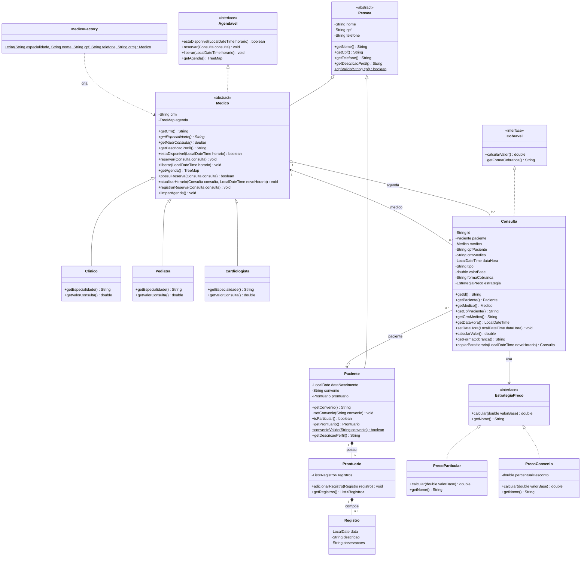
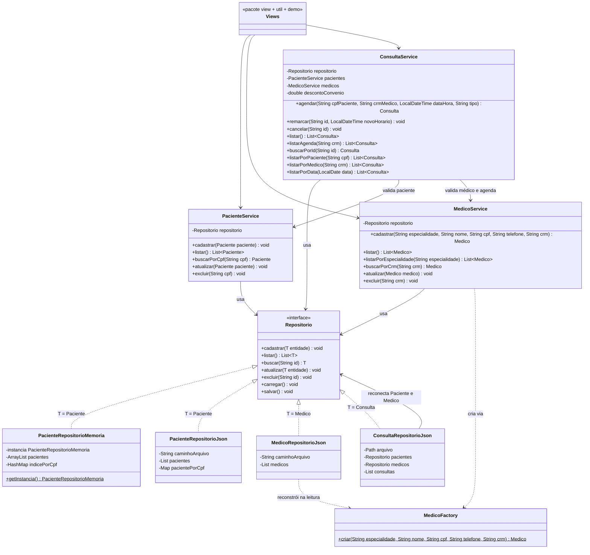

# Sistema Clínico

Projeto final de Programação Orientada a Objetos (UFAL Arapiraca): CRUD de **Pacientes**, **Médicos** e **Consultas** em Java, com interface JavaFX e persistência em JSON.

**Equipe:** Maria Fernanda · Giovanna Sophia · Luan Henrique

---

## 1. Como rodar

### Pré-requisitos

| Ferramenta | Versão |
|---|---|
| JDK | **21 ou superior** (o projeto compila com `release 21`; testado também em JDK 26) |
| Apache Maven | 3.6+ |
| JavaFX | **21.0.5** (gerenciado pelo `pom.xml`, não precisa instalar separadamente) |

Verifique com `java -version` e `mvn -version`.

### Passo a passo

```bash
# 1. Clone o repositório
git clone https://github.com/mfernanda2218/sistema-clinico.git
cd sistema-clinico

# 2. Compile o projeto
mvn clean compile

# 3. Rode a aplicação (interface gráfica)
mvn javafx:run
```

A janela "Sistema Clínico - UFAL Arapiraca" abre com três abas: **Pacientes**, **Médicos** e **Consultas**.

> **Não é preciso baixar JavaFX manualmente.** As dependências `org.openjfx:javafx-controls` e `javafx-fxml` (21.0.5) são resolvidas pelo Maven e incluídas no classpath automaticamente.

### Executar os testes

```bash
mvn test
```

São 30 testes (JUnit 4) cobrindo modelo, repositórios JSON, services e telas.

### Executar o fluxo de demonstração (console)

```bash
mvn compile exec:java -Dexec.mainClass=clinica.demo.FluxoCompletoMain
```

O demo cadastra um paciente e um médico, agenda consultas, cancela uma e simula um reinício relendo os JSONs.

> **Atenção:** o demo falha com `Paciente com CPF já cadastrado` se a pasta `dados/` já contiver esses registros. Apague `dados/` antes de rodar novamente, ou use os CPFs já cadastrados.

---

## 2. Onde ficam os dados (JSONs)

Os dados são persistidos em arquivos JSON dentro da pasta **`dados/`**, criada automaticamente na raiz do projeto na primeira gravação:

```
dados/
├── pacientes.json   # Paciente + Prontuario + Registro aninhados
├── medicos.json     # Medico + especialidade
└── consultas.json   # Consulta (referências por cpfPaciente/crmMedico)
```

- O diretório `dados/` está no `.gitignore` — **dados de execução nunca são versionados**.
- Os arquivos são gravados a cada operação (cadastrar/atualizar/excluir) e relidos na inicialização — o sistema é resiliente a fechamento sem "salvar".
- `MainApp` aceita um `Path` customizado no construtor (usado pelos testes com pasta temporária); o default é `dados/` relativo ao diretório de trabalho.
- Se um JSON estiver corrompido, o sistema lança `ArquivoInvalidoException` na carga e **não sobrescreve** o arquivo.

---

## 3. Tecnologias

| Componente | Versão / Tecnologia |
|---|---|
| Linguagem | Java **21** (`maven.compiler.release=21`) |
| UI | JavaFX **21.0.5** (controls + FXML deps; telas montadas em código, sem arquivos `.fxml`) |
| Persistência | JSON via Gson **2.11.0** |
| Build | Apache Maven (`maven-compiler-plugin` 3.13.0) |
| Testes | JUnit **4.13.2** |
| Plugins | `javafx-maven-plugin` 0.0.8, `exec-maven-plugin` 3.5.0 |

---

## 4. Estrutura de pacotes

| Pacote | Conteúdo |
|---|---|
| `clinica.model` | `Pessoa`, `Paciente`, `Prontuario`, `Registro`, `Medico` e subclasses, `Consulta`, estratégias de preço |
| `clinica.interfaces` | `Agendavel`, `Cobravel`, `EstrategiaPreco`, `Repositorio<T>` |
| `clinica.exception` | Exceptions do domínio e da persistência |
| `clinica.repository` | Implementações de `Repositorio<T>` (memória e JSON) |
| `clinica.service` | Regras de negócio, `MedicoFactory` |
| `clinica.util` | `AlertaUtil` (dialogs JavaFX) e `ValidadorUtil` (regras de formulário) |
| `clinica.view` | Telas JavaFX (`MainApp`, `NavegacaoView`, `PacienteView`, `MedicoView`, `ConsultaView`) |
| `clinica.demo` | `MainDemo` e `FluxoCompletoMain` — fluxo de verificação manual em console |

Fluxo de dependência: `view → service → repository → arquivos JSON`. A `view` nunca acessa o `repository` diretamente; `util` e `demo` são folhas (não são usados pelas camadas de negócio).

---

## 5. Diagramas de classes

### 5.1 Domínio (model, interfaces, Factory e Strategy)



**Notas:**
- `Medico.agenda` é `transient`: não vai para o JSON. O `Medico` implementa `Agendavel`, mantendo a responsabilidade e o encapsulamento dos seus próprios horários. `registrarReserva()`/`limparAgenda()` existem para o `ConsultaRepositorioJson` reconstruir a agenda em memória ao carregar o arquivo — sem isso, a agenda ficaria vazia após reiniciar o app.
- `Consulta` tem `id` próprio (`UUID` em texto), com `equals`/`hashCode` baseados nele, permitindo identificação estável e uso unificado de `Repositorio.buscar(String id)`.
- `Consulta` associa-se por objeto a `Paciente` e `Medico` (ambos `transient`). No JSON persistem-se apenas `cpfPaciente` e `crmMedico`; ao carregar, o repositório reconecta os objetos reais.
- `formaCobranca` é persistida como texto (`"Particular"` ou `"Convênio"` acompanhada de `percentualDesconto`), e a respectiva `EstrategiaPreco` é reconstruída na leitura.
- `Pessoa.cpfValido()` valida CPF por dígitos verificadores (módulo 11) e é usada tanto no setter quanto na carga do JSON e nos formulários.

### 5.2 Persistência, serviços e telas



**Notas:**
- No `pacientes.json`, o prontuário e seus registros ficam aninhados dentro do paciente.
- `ConsultaRepositorioJson` usa um `TypeAdapter` para `LocalDateTime`, grava em arquivo temporário + `ATOMIC_MOVE` (evita JSON truncado em queda) e recebe instâncias de `Repositorio<Paciente>` e `Repositorio<Medico>` para reconstruir a associação por objetos e a agenda dos médicos.
- **Singleton:** Mantido exclusivamente em `PacienteRepositorioMemoria` para atender ao requisito acadêmico de padrões de projeto. Os repositórios JSON **não** são Singletons, garantindo testabilidade isolada com arquivos temporários e injeção de dependências.
- **Tratamento de Exceções:** Repositórios lançam `IllegalArgumentException` (para ID duplicado ou inexistente); os *services* traduzem para as exceções de domínio (`PacienteNaoEncontradoException`, `MedicoNaoEncontradoException`, `ConsultaNaoEncontradaException`). Validações de entrada no `model` usam `IllegalArgumentException`.
- **Persistência (`carregar()` e `salvar()`):** Métodos `default` na interface `Repositorio<T>` garantem suporte à persistência nos repositórios JSON sem onerar o repositório em memória.

---

## 6. Contratos (assinaturas fixadas)

Estes são os contratos definidos no início da implementação do projeto.

### 6.1 Classes abstratas

```java
// clinica.model
public abstract class Pessoa {
    // atributos private: nome, cpf, telefone (validados nos setters)
    public abstract String getDescricaoPerfil();
}
 
public abstract class Medico extends Pessoa implements Agendavel {
    // atributos private: crm; transient TreeMap<LocalDateTime, Consulta> agenda (inicializada no construtor)
    public abstract String getEspecialidade();   // "Clínico", "Pediatra", "Cardiologista"
    public abstract double getValorConsulta();   // valor base próprio de cada especialidade
}
```

#### Associação da `Consulta` (por objeto)

```java
public class Consulta implements Cobravel {
    private String id;
    private transient Paciente paciente;   // associação por objeto (aula 09)
    private transient Medico medico;       // associação por objeto (aula 09)
    private String cpfPaciente;            // gravado no JSON
    private String crmMedico;              // gravado no JSON
    // ... dataHora, tipo, valorBase, formaCobranca, estrategia
}
```

### 6.2 Interfaces

```java
// clinica.interfaces
public interface Agendavel {
    boolean estaDisponivel(LocalDateTime horario);
    void reservar(Consulta consulta) throws HorarioIndisponivelException;
    void liberar(LocalDateTime horario);
    TreeMap<LocalDateTime, Consulta> getAgenda();    // ordenada por horário
}
 
public interface Cobravel {
    double calcularValor();        // valor final já com a estratégia aplicada
    String getFormaCobranca();     // "Particular" ou "Convênio"
}
 
public interface EstrategiaPreco {
    double calcular(double valorBase);
    String getNome();
}
 
public interface Repositorio<T> {
    void cadastrar(T entidade);                       // IllegalArgumentException se o id já existe
    List<T> listar();                                 // devolve cópia, nunca a lista interna
    T buscar(String id);                              // id = CPF | CRM | id da consulta; null se não existir
    void atualizar(T entidade);                       // IllegalArgumentException se o id não existe
    void excluir(String id);                          // IllegalArgumentException se o id não existe
    void carregar() throws ArquivoInvalidoException;  // no JSON lê o arquivo; na memória não faz nada
    void salvar();                                    // no JSON grava o arquivo; na memória não faz nada
}
```

Falha de escrita em disco vira `UncheckedIOException` (não polui a assinatura dos métodos de CRUD).

### 6.3 Factory

```java
// clinica.service
public class MedicoFactory {
    public static Medico criar(String especialidade, String nome, String cpf,
                               String telefone, String crm);
    // especialidade desconhecida -> IllegalArgumentException (nunca devolve null)
}
```

### 6.4 Services (o que a view enxerga)

`Paciente.setConvenio` e o construtor com convênio lançam
`ConvenioInvalidoException` para texto vazio ou nome fora de `CONVENIOS_ACEITOS`.
A lista inicial contém `Unimed`, conforme o exemplo existente, e deve ser ajustada
quando a equipe definir outros convênios. Espaços nas pontas e diferenças entre
maiúsculas e minúsculas são aceitos. `null` representa atendimento particular.
Quem usar o construtor com convênio ou o setter deve tratar a exceção com
`try/catch` ou declará-la com `throws`.
 
```java
public class PacienteService {
    public void cadastrar(Paciente p);
    public List<Paciente> listar();
    public Paciente buscarPorCpf(String cpf) throws PacienteNaoEncontradoException;
    public void atualizar(Paciente p) throws PacienteNaoEncontradoException;
    public void excluir(String cpf) throws PacienteNaoEncontradoException;
}
 
public class MedicoService {
    public Medico cadastrar(String especialidade, String nome, String cpf,
                            String telefone, String crm);
    public List<Medico> listar();
    public List<Medico> listarPorEspecialidade(String especialidade);
    public Medico buscarPorCrm(String crm) throws MedicoNaoEncontradoException;
    public void atualizar(Medico m) throws MedicoNaoEncontradoException;
    public void excluir(String crm) throws MedicoNaoEncontradoException;
}
 
public class ConsultaService {
    public Consulta agendar(String cpfPaciente, String crmMedico, LocalDateTime dataHora,
                            String tipo) throws PacienteNaoEncontradoException,
                            MedicoNaoEncontradoException, HorarioIndisponivelException;
    public void remarcar(String id, LocalDateTime novoHorario)
                            throws ConsultaNaoEncontradaException, HorarioIndisponivelException;
    public void cancelar(String id) throws ConsultaNaoEncontradaException;
    public List<Consulta> listar();
    public Consulta buscarPorId(String id) throws ConsultaNaoEncontradaException;
    public List<Consulta> listarPorPaciente(String cpf);
    public List<Consulta> listarPorMedico(String crm);
    public List<Consulta> listarPorData(LocalDate data);
}
```

### 6.5 Exceptions

Exceções de domínio são *checked* (estendem `Exception`); erros de entrada no `model` usam `IllegalArgumentException` (não checked).

| Exception | Quem lança | Quando |
|---|---|---|
| `PacienteNaoEncontradoException` | `PacienteService`, `ConsultaService` | CPF inexistente |
| `ConvenioInvalidoException` | `Paciente` (construtor e `setConvenio`) | convênio vazio ou fora da lista aceita |
| `MedicoNaoEncontradoException` | `MedicoService`, `ConsultaService` | CRM inexistente |
| `ConsultaNaoEncontradaException` | `ConsultaService` | id de consulta inexistente |
| `HorarioIndisponivelException` | `Medico.reservar`, propagada por `ConsultaService` | médico já tem consulta no horário |
| `ArquivoInvalidoException` | `carregar()` dos repositórios JSON | JSON existe, mas está corrompido/inconsistente |

Na interface, toda exception é capturada e mostrada em `Alert`, sem stack trace.

---

## 7. Onde cada conceito de O.O. aparece

| Conceito | Onde |
|---|---|
| Classes e objetos | Todo o `model`; construtores com validação |
| Herança e polimorfismo | `Pessoa → Paciente/Medico`; `Medico → Clinico/Pediatra/Cardiologista` (`getValorConsulta()`, `getEspecialidade()`) |
| Modificadores e encapsulamento | Atributos `private`, `protected` só nas hierarquias, constantes `static final` |
| Exception | Tabela da seção 6.5 |
| Classe abstrata e interface | `Pessoa`, `Medico`; `Agendavel`, `Cobravel`, `EstrategiaPreco`, `Repositorio<T>` |
| Associação e composição | `Paciente ◆ Prontuario ◆ Registro` (composição); `Consulta` associa `Paciente` e `Medico` por referência de objeto (CPF/CRM só no JSON) |
| Estruturas de dados | `ArrayList`, `HashMap` (índice por CPF), `TreeMap` (agenda ordenada) |
| Padrões de projeto | Singleton (`PacienteRepositorioMemoria`), Factory (`MedicoFactory`), Strategy (`EstrategiaPreco`) |

---

## 8. Quem fez o quê

| Integrante | Área de maior contribuição |
|---|---|
| **Maria Fernanda** | Persistência (`repository`), services e telas |
| **Giovanna Sophia** | Telas JavaFX e partes do domínio (`model`) |
| **Luan Henrique** | Domínio (`model`) e suíte de testes |

> Contribuições distribuídas em todas as camadas — a tabela resume a área de maior volume de commits de cada integrante.

---

## 9. Roteiro de Teste de Persistência

Este roteiro valida se os dados das três entidades (Paciente, Médico e Consulta) 
sobrevivem ao ciclo: **cadastrar → fechar o aplicativo → reabrir**.

### Pré-requisitos
- Aplicativo compilando e rodando (`mvn clean javafx:run`)
- Arquivos JSON sendo salvos em `dados/` (pacientes.json, medicos.json, consultas.json)

---

### 1. Preparação (limpar dados anteriores – opcional)
1. Feche o aplicativo se estiver aberto.
2. Apague (ou renomeie) a pasta `dados/` para começar do zero.
3. Execute o aplicativo novamente.

---

### 2. Cadastro de Pacientes
1. Vá na aba **Pacientes**.
2. Cadastre **dois pacientes**:
   - Paciente 1: com convênio (ex: Unimed)
   - Paciente 2: particular (deixe o campo convênio vazio)
3. No paciente 1, abra o **Prontuário** e adicione **pelo menos 2 registros**.
4. Anote os CPFs e os dados principais.

---

### 3. Cadastro de Médicos
1. Vá na aba **Médicos**.
2. Cadastre **três médicos**, um de cada especialidade:
   - 1 Clínico
   - 1 Pediatra
   - 1 Cardiologista
3. Anote os CRMs e as especialidades.

---

### 4. Cadastro de Consultas
1. Vá na aba **Consultas**.
2. Agende **pelo menos 2 consultas**:
   - Uma para o paciente particular
   - Uma para o paciente com convênio
3. Use médicos diferentes.
4. Anote data/hora e valor calculado de cada consulta.

---

### 5. Fechamento e Reabertura
1. Feche o aplicativo pelo **X** da janela (não pelo terminal).
2. Confirme que os arquivos JSON foram gerados/atualizados na pasta `dados/`.
3. Execute novamente: `mvn javafx:run`

---

### 6. Verificação (ponto crítico)
Após reabrir, confira **item por item**:

#### Pacientes
- [ ] Os dois pacientes voltaram
- [ ] O convênio do paciente 1 está correto
- [ ] O paciente 2 continua como particular
- [ ] Os registros do prontuário do paciente 1 ainda existem (data + descrição)

#### Médicos
- [ ] Os três médicos voltaram
- [ ] Cada um voltou com a **especialidade correta** (Clínico, Pediatra, Cardiologista)
- [ ] O comportamento polimórfico está preservado (ex: valor da consulta diferente por tipo)

#### Consultas
- [ ] As duas consultas voltaram
- [ ] Data e hora estão corretas (sem perda de informação)
- [ ] O valor calculado está igual ao que foi mostrado antes de fechar
- [ ] O vínculo com paciente (CPF) e médico (CRM) está correto

---

### 7. Resultado do teste

| Integrante       | Data       | Passou? | Observações / Bugs encontrados |
|------------------|------------|---------|--------------------------------|
| A (mfernanda)    |            |         |                                |
| B (giovanna)     |            |         |                                |
| C (luan)         |            |         |                                |

> Qualquer falha encontrada deve virar uma issue com a label `bug`.
