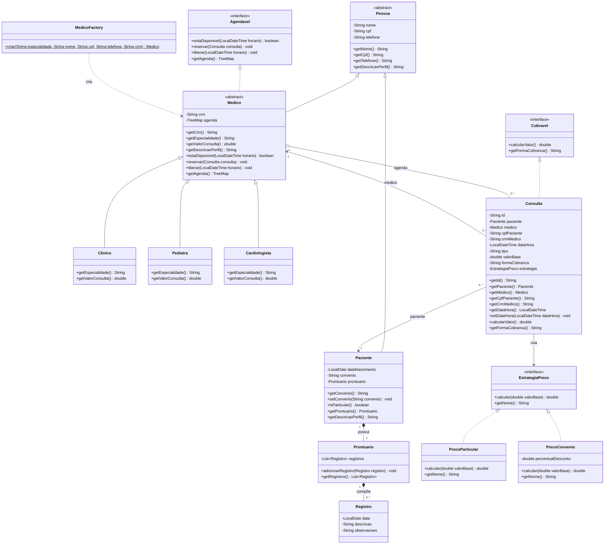
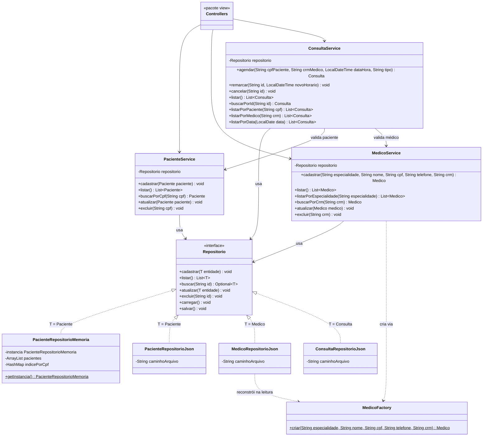

# Sistema Clínico
 
Projeto final de Programação Orientada a Objetos (UFAL Arapiraca): CRUD de **Pacientes**, **Médicos** e **Consultas** em Java, com interface JavaFX e persistência em JSON.
 
**Equipe:** mfernanda2218 (A: Paciente/Prontuário) · giovannaalopes (B: Médico/Especialidades) · devlu4n (C: Consulta/Cobrança)
 
> Este README é um documento vivo. Esta versão cobre a issue **#2** (UML e contratos). A issue **#35** o completa com as instruções de execução.
 
---
 
## 1. Estrutura de pacotes
 
| Pacote | Conteúdo |
|---|---|
| `clinica.model` | `Pessoa`, `Paciente`, `Prontuario`, `Registro`, `Medico` e subclasses, `Consulta`, estratégias de preço |
| `clinica.interfaces` | `Agendavel`, `Cobravel`, `EstrategiaPreco`, `Repositorio<T>` |
| `clinica.exception` | Exceptions do domínio e da persistência |
| `clinica.repository` | Implementações de `Repositorio<T>` (memória e JSON) |
| `clinica.service` | Regras de negócio, `MedicoFactory` |
| `clinica.view` | Telas JavaFX (controllers + FXML) |
 
Fluxo de dependência: `view → service → repository → arquivos JSON`. A `view` nunca acessa o `repository` diretamente.
 
---
 
## 2. Diagramas de classes
 
### 2.1 Domínio (model, interfaces, Factory e Strategy)
 

 
**Notas:**
- `Medico.agenda` é `transient`: não vai para o JSON. O service a reconstrói ao carregar as consultas.
- `Consulta` tem referências de objeto para `Paciente` e `Medico` (associação), ambas `transient`. No JSON vão só `cpfPaciente` e `crmMedico`; ao carregar, o service busca pelos identificadores e reconecta os objetos.
### 2.2 Persistência, serviços e telas
 

 
**Notas:**
- No `pacientes.json`, o prontuário e seus registros ficam aninhados dentro do paciente.
- `ConsultaRepositorioJson` usa um `TypeAdapter` para `LocalDateTime`.
---
 
## 3. Contratos (assinaturas fixadas)
 
Estes são os contratos que **não mudam sem avisar os três**. O que está dentro dos métodos fica livre.
 
### 3.1 Classes abstratas
 
```java
// clinica.model
public abstract class Pessoa {
    // atributos private: nome, cpf, telefone (validados nos setters)
    public abstract String getDescricaoPerfil();
}
 
public abstract class Medico extends Pessoa implements Agendavel {
    // atributos private: crm; transient TreeMap<LocalDateTime, Consulta> agenda (inicializada no construtor)
    public abstract String getEspecialidade();   // "Clínico", "Pediatra", "Cardiologista"
    public abstract double getValorConsulta();   // valor base próprio de cada especialidade
}
```
 
#### Associação da `Consulta` (por objeto)
 
```java
public class Consulta implements Cobravel {
    private String id;
    private transient Paciente paciente;   // associação por objeto (aula 09)
    private transient Medico medico;       // associação por objeto (aula 09)
    private String cpfPaciente;            // gravado no JSON
    private String crmMedico;              // gravado no JSON
    // ... dataHora, tipo, valorBase, formaCobranca, estrategia
}
```
 
### 3.2 Interfaces
 
```java
// clinica.interfaces
public interface Agendavel {
    boolean estaDisponivel(LocalDateTime horario);
    void reservar(Consulta consulta) throws HorarioIndisponivelException;
    void liberar(LocalDateTime horario);
    TreeMap<LocalDateTime, Consulta> getAgenda();    // ordenada por horário
}
 
public interface Cobravel {
    double calcularValor();        // valor final já com a estratégia aplicada
    String getFormaCobranca();     // "Particular" ou "Convênio"
}
 
public interface EstrategiaPreco {
    double calcular(double valorBase);
    String getNome();
}
 
public interface Repositorio<T> {
    void cadastrar(T entidade);                       // IllegalArgumentException se o id já existe
    List<T> listar();                                 // devolve cópia, nunca a lista interna
    Optional<T> buscar(String id);                    // id = CPF | CRM | id da consulta
    void atualizar(T entidade);                       // IllegalArgumentException se o id não existe
    void excluir(String id);                          // IllegalArgumentException se o id não existe
    void carregar() throws ArquivoInvalidoException;  // no JSON lê o arquivo; na memória não faz nada
    void salvar() throws ArquivoInvalidoException;    // no JSON grava o arquivo; na memória não faz nada
}
```
 
Falha de escrita em disco vira `UncheckedIOException` (não polui a assinatura dos métodos de CRUD).
 
### 3.3 Factory
 
```java
// clinica.service
public class MedicoFactory {
    public static Medico criar(String especialidade, String nome, String cpf,
                               String telefone, String crm);
    // especialidade desconhecida -> IllegalArgumentException (nunca devolve null)
}
```
 
### 3.4 Services (o que a view enxerga)
 
```java
public class PacienteService {
    public void cadastrar(Paciente p);
    public List<Paciente> listar();
    public Paciente buscarPorCpf(String cpf) throws PacienteNaoEncontradoException;
    public void atualizar(Paciente p) throws PacienteNaoEncontradoException;
    public void excluir(String cpf) throws PacienteNaoEncontradoException;
}
 
public class MedicoService {
    public Medico cadastrar(String especialidade, String nome, String cpf,
                            String telefone, String crm);
    public List<Medico> listar();
    public List<Medico> listarPorEspecialidade(String especialidade);
    public Medico buscarPorCrm(String crm) throws MedicoNaoEncontradoException;
    public void atualizar(Medico m) throws MedicoNaoEncontradoException;
    public void excluir(String crm) throws MedicoNaoEncontradoException;
}
 
public class ConsultaService {
    public Consulta agendar(String cpfPaciente, String crmMedico, LocalDateTime dataHora,
                            String tipo) throws PacienteNaoEncontradoException,
                            MedicoNaoEncontradoException, HorarioIndisponivelException;
    public void remarcar(String id, LocalDateTime novoHorario)
                            throws ConsultaNaoEncontradaException, HorarioIndisponivelException;
    public void cancelar(String id) throws ConsultaNaoEncontradaException;
    public List<Consulta> listar();
    public Consulta buscarPorId(String id) throws ConsultaNaoEncontradaException;
    public List<Consulta> listarPorPaciente(String cpf);
    public List<Consulta> listarPorMedico(String crm);
    public List<Consulta> listarPorData(LocalDate data);
}
```
 
### 3.5 Exceptions (todas *checked*, estendem `Exception`)
 
| Exception | Quem lança | Quando | Issue |
|---|---|---|---|
| `PacienteNaoEncontradoException` | `PacienteService`, `ConsultaService` | CPF inexistente | #6 |
| `ConvenioInvalidoException` | `Paciente` (construtor e `setConvenio`) | convênio vazio ou fora da lista aceita (constante em `Paciente`) | #6 |
| `MedicoNaoEncontradoException` | `MedicoService`, `ConsultaService` | CRM inexistente | #19 (nova) |
| `ConsultaNaoEncontradaException` | `ConsultaService` | id de consulta inexistente | #24 (nova) |
| `HorarioIndisponivelException` | `Medico.reservar`, propagada por `ConsultaService` | médico já tem consulta no horário | #14 |
| `ArquivoInvalidoException` | `carregar()` dos repositórios JSON | JSON existe, mas está corrompido | #27 |
 
Na interface, toda exception é capturada e mostrada em `Alert`, sem stack trace.
 
---
 
## 4. Onde cada conceito de O.O. aparece
 
| Conceito | Onde |
|---|---|
| Classes e objetos | Todo o `model`; construtores com validação |
| Herança e polimorfismo | `Pessoa → Paciente/Medico`; `Medico → Clinico/Pediatra/Cardiologista` (`getValorConsulta()`, `getEspecialidade()`) |
| Modificadores e encapsulamento | Atributos `private`, `protected` só nas hierarquias, constantes `static final` |
| Exception | Tabela da seção 3.5 |
| Classe abstrata e interface | `Pessoa`, `Medico`; `Agendavel`, `Cobravel`, `EstrategiaPreco`, `Repositorio<T>` |
| Associação e composição | `Paciente ◆ Prontuario ◆ Registro` (composição); `Consulta` associa `Paciente` e `Medico` por referência de objeto (CPF/CRM só no JSON) |
| Estruturas de dados | `ArrayList`, `HashMap` (índice por CPF), `TreeMap` (agenda ordenada) |
| Padrões de projeto | Singleton (`PacienteRepositorioMemoria`), Factory (`MedicoFactory`), Strategy (`EstrategiaPreco`) |
 
---
 
## 5. Decisões de modelagem a confirmar
 
Estas escolhas foram feitas para fechar o diagrama e **ajustam levemente** algumas issues. Confirmar na revisão do PR:
 
1. **Agenda dentro do `Medico`** (`transient TreeMap`), com `Agendavel` incluindo `reservar` e `liberar`. A issue #23 dizia que o `ConsultaService` mantinha o `TreeMap`; agora ele delega ao médico. A issue #8 passa a ter 4 métodos, não 2.
2. **`Consulta` tem `id` próprio** (UUID em texto), assim `Repositorio.buscar(String id)` serve para as três entidades.
3. **Repositório lança `IllegalArgumentException`** (id duplicado ou inexistente); os *services* traduzem para as exceptions de domínio.
4. **Duas exceptions novas** que o backlog ainda não previa: `MedicoNaoEncontradoException` (junto da #19) e `ConsultaNaoEncontradaException` (junto da #24).
5. **`Repositorio` tem `carregar()` e `salvar()`**, que sustentam as issues #27 e #33 (carregar ao abrir e salvar ao fechar).
6. **Forma de cobrança gravada como texto** em `Consulta`; a `EstrategiaPreco` é reconstruída na leitura (issue #22).
7. **Singleton só no `PacienteRepositorioMemoria`**, como na #15. Decidir se os repositórios JSON também serão Singleton.
8. **`Consulta` associa por objeto**, e não só por texto. Nos slides de associação (aula 09, p.5-7) a classe sempre guarda um atributo do tipo da outra classe. Por isso `paciente` e `medico` são `transient`, e o JSON grava apenas `cpfPaciente` e `crmMedico`. Isso ajusta as issues #11, #22 e #23.